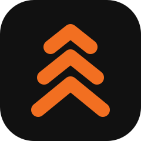

<p align="center">
  
</p>

<h1 align="center">Rackd</h1>

<p align="center">
  A workout tracker that's fast enough to use mid-set, offline-first, and shared with family.
</p>

<p align="center">
  
  
  
  
</p>

<p align="center">
  <a href="https://rackd.someshrao.fyi/"><b>Open the live app →</b></a>
</p>

<p align="center">
  <a href="#features">Features</a> ·
  <a href="#tech-stack">Tech stack</a> ·
  <a href="#architecture">Architecture</a> ·
  <a href="#getting-started">Getting started</a> ·
  <a href="#deploy">Deploy</a> ·
  <a href="#roadmap">Roadmap</a>
</p>

---

Pick a lift, log weight + reps, and the app auto-fills your last numbers so logging takes one tap.
No signal in the gym is fine — it syncs when you're back online.

Most trackers stop at logging. Rackd also decides **what you train next** — plan days rotate on
a schedule you choose, weights and reps come from your own history and logged intensity, and the
session eases itself on days you report as run-down.

## Features

### Logging & sync

- **Offline-first logging** — RxDB on IndexedDB. The app is fully usable with no connection;
  writes replicate to Cloudflare D1 when you're back online (last-write-wins, no CRDTs). Log
  against a plan, or start a plan-free "Freestyle" session and log on the fly.
- **Accounts & sync** — Email/password or Google sign-in, with name and date of birth captured at
  signup and editable later in Settings. Sign in on another device and everything is restored.
- **Installable PWA** — Add to home screen, kg↔lb toggle, and full JSON data export.

### Plans & sessions

- **Plans & scheduling** — Build a plan of days (Push/Pull/Legs) and slots, or adopt one of 10
  curated goal-tagged starter plans. Each slot has an anchor lift plus 4–5 alternatives so you can
  rotate equipment without losing progressive overload on the main movement. Enroll a plan with a
  start date and training weekdays; days rotate across them and self-heal over missed sessions.
  Today shows the scheduled day immediately — sectioned by slot label, with no lock step. The day
  is held in memory and written only on your first real action, so opening the app never creates a
  session or nudges the rotation. A calendar strip shows finished workouts and what's coming up. An
  explicit "Finish workout" action advances the rotation, and so does skipping a day — a skip moves
  the plan on to the next day rather than letting the missed one slide forward, without counting as
  training (it never inflates a streak) and with an undo. Share plans by code as immutable
  snapshots. Adopted starter plans can refresh their exercise pools to access the latest alternatives.
- **Session generation** — Give it a time budget and it assigns sets and target reps per exercise,
  reps by movement role and sets grown greedily with compounds first, using your own rest and
  working-set timings. Filters by your environment and available equipment. Each slot's anchor lift
  is always proposed when it survives filtering, so main lifts progress uninterrupted. An optional
  "Customize" screen adds alternative movements to a slot or re-times the day; added movements appear
  grouped on Today and can be saved back to the plan. Each exercise gets its own independent logger and
  budget allocation, and lifts can be swapped mid-session.
- **Timed circuits** — Plan days can define work/rest intervals and rounds, driven by an on-screen
  countdown with a progress ring and audio cues.
- **In-session tools** — Warm-up sets stepped down from your last working weight, tap one to log
  it (it's recorded but kept out of your set targets, volume, PRs and progression), per-side
  barbell plate math built from the plates you actually own (set in Settings), editable
  mobility warm-up and cooldown blocks (add/remove moves, adjust hold times 15–60s; ticked-off moves
  persist across a reload) on a countdown, mid-workout swaps, and add-an-exercise — which files itself
  under the matching muscle section of the day — that can be saved back into the plan so it recurs.
  Each exercise row also carries a Load panel — the weight step this lift actually jumps in, plus the
  bar weight and per-side stack on barbell lifts — and a Remove control that drops the lift from just
  this session or from the plan for good. Tweaked something? Rest a single lift or a whole muscle
  group, temporarily or permanently.

### Coaching

- **Progression & intensity** — Double progression (reps 8→12, then equipment-aware load jump) or linear
  (% of estimated 1RM). Per-equipment weight increments (barbell/cable 2.5 kg, dumbbell 2 kg, machine
  5 kg, etc.) with per-exercise overrides for stubborn machines. Bodyweight lifts log reps-only (shown
  as BW × reps, e.g., BW × 12). Suggests next-session weight and reps from your history and RIR,
  estimates 1RM via Epley, regresses load after a break, and offers a deload when fatigue accumulates.
- **Equipment-aware substitution** — No barbell? "Use dumbbells instead" rewrites a plan's barbell
  lifts to dumbbell equivalents. Slots that match nothing in your kit auto-swap to a catalog
  equivalent, labelled so you can see it happened.
- **Recovery & consistency** — A three-tap daily readiness check-in (sleep / soreness / energy)
  produces a 0–100 score that feeds the progression engine. Training streaks forgive up to two rest
  days, with a nudge when you fall off pace. Personal records are detected and celebrated.

### Library & progress

- **Exercise library** — 1,937 exercises (including 134 stretches), searchable and filterable by muscle group, movement
  pattern, and equipment. 1,254 carry animated demonstration GIFs. Detail cards show worked muscles
  on an anatomical body map, instructions, and your cross-session records. When building a plan or
  adding exercises mid-session, you can multi-select exercises at once and view inline details without
  losing your selection. Add your own custom exercises with an optional category (Strength or Mobility) — 
  the app auto-tags the muscles they work from the name.
- **Progress tracking** — Volume by muscle group over 7/14/30/365-day windows with drill-down to 17
  individual muscles and a body-map heatmap. Weight-loss, strength, and hypertrophy goals with
  adaptive suggestions. Body weight and measurements with a trend sparkline.

> [!NOTE]
> Not built yet: the optional bring-your-own-key AI layer and progress photos. See [Roadmap](#roadmap).

## Tech stack

| Layer | Technology |
|---|---|
| Frontend | React 19 + TypeScript, Vite, Tailwind CSS, React Router |
| Drag-and-drop | @dnd-kit (core, sortable, utilities) |
| Local data | RxDB on Dexie (IndexedDB) — local-first, offline by default |
| Backend | Cloudflare Pages Functions (Workers) |
| Database | Cloudflare D1 (SQLite) |
| Auth | Google OAuth + email/password, stateless JWT |
| PWA | vite-plugin-pwa |

## Architecture

```
Browser (PWA, React + Vite)
  ├─ RxDB + Dexie (IndexedDB)   — local-first store, works offline
  │   ├─ exercises              — seeded catalog, local only (not synced)
  │   ├─ sessions + setlogs     — append-only log of lifts
  │   ├─ plans                  — workout plans, schedule, progression scheme
  │   ├─ exclusions             — temporary/permanent movement exclusions
  │   ├─ goals                  — weight-loss / strength / hypertrophy goals
  │   ├─ bodymetrics            — weight + measurements log
  │   ├─ readiness              — daily recovery check-in, one row per day
  │   └─ customexercises        — user-created exercises with tagged muscles
  ├─ localStorage               — device-local environment, equipment, weight increments, plates, and sex prefs
  ├─ static exercise catalog    — seeded once, versioned JSON (exercises.v1.json + aliases.v1.json)
  ├─ body-map SVG paths         — anatomical male/female muscle map
  └─ JWT held client-side
        │  (online only)
        ▼
Cloudflare Pages Functions
  ├─ /auth/*          — Google OAuth + email/password → mint JWT; /auth/account edits profile
  ├─ /sync/{pull,push}/{collection}
  │                   — replicate the 8 synced collections; upsert + tombstone into D1
  ├─ /share/publish   — publish a plan snapshot (owner-keyed upsert, stable share code)
  ├─ /share/[code]    — fetch a shared plan snapshot
  └─ /push/subscribe  — store a Web Push subscription (sending is deploy-gated)
        ▼
D1 (SQLite) — per-user rows: users, sessions, setlogs, plans, exclusions,
                             goals, bodymetrics, readiness, customexercises
            — cross-user immutable rows: shared_plans
            — server-only rows: push_subscriptions
            ↕ pull restores the same data on a new device
```

**Sync model:** client-generated UUID `id`, `createdAt`/`updatedAt`, `deletedAt` tombstone, last-write-wins
by `updatedAt`. `userId` is always taken from the verified JWT and never from the request body — that's
the per-user isolation boundary.

## Getting started

### Logging only — no sync, no auth

```bash
npm install
npm run seed           # build the exercise catalog into public/catalog/
npm run seed:plans     # generate starter plans
npm run seed:bodymap   # pull anatomical body-map SVG paths
npm run dev            # → http://localhost:5173
```

> [!TIP]
> Create `.env.development.local` with `VITE_AUTH_STUB=1` to skip the Google sign-in screen and sign
> in as "Local Dev". This uses a client-only token that the backend does not accept, so `/sync` is
> unavailable — use email/password login if you need to test sync and data replication.

### Full stack — auth, sync and sharing against local D1

```bash
cp .dev.vars.example .dev.vars                        # set JWT_SECRET; Google keys optional
npx wrangler d1 migrations apply workout-db --local   # create local D1 tables
npm run seed && npm run seed:plans && npm run seed:bodymap

npm run dev:api   # terminal 1 — Pages Functions + local D1 on http://localhost:8788
npm run dev       # terminal 2 — app on http://localhost:5173 (proxies /auth + /sync)
```

Open the app at **http://localhost:5173** (not :8788). Both processes must be running for sign-in,
sync, and plan sharing to work.

Set `AUTH_STUB=1` in `.dev.vars` to sign in without a real Google OAuth client — it adds
`/auth/dev-login`, which mints a real JWT for a fake identity. Email/password sign-in always works
against local D1 and doesn't need this flag.

> [!CAUTION]
> **Never set `AUTH_STUB` in production.**

### Tests

```bash
npm run smoke   # RxDB schema sanity check (9 collections)
npm run test    # sync replication, rotation, generation, lifting math, progression, volume,
                # goals, readiness, consistency, PRs, gamification, scheduling, circuits,
                # exercise filtering, plan editing, equipment substitution, day sections
```

## Deploy

Deployed as a Cloudflare Pages project (`rackd`, build output `dist`).

```bash
npm run build
npx wrangler pages deploy                             # project: rackd
npx wrangler d1 migrations apply workout-db --remote  # apply migrations to production D1
```

Set production secrets once — never commit them:

```bash
npx wrangler pages secret put GOOGLE_CLIENT_ID
npx wrangler pages secret put GOOGLE_CLIENT_SECRET
npx wrangler pages secret put JWT_SECRET
```

> [!IMPORTANT]
> In the Google Cloud console, add the deployed callback as an authorized redirect URI
> (`https://<your-domain>/auth/google/callback`). Web Push additionally needs a VAPID key pair —
> see `.dev.vars.example`. Make sure `AUTH_STUB` is **not** set in the production environment.

## Roadmap

| Item | Status |
|---|---|
| Optional AI layer | Bring your own AI key to improve plans and recommendations. Never required — the app works fully without it. |
| Progress photos | Deferred. |

Nutrition tracking, wearable integrations, and AI form-checking are under consideration but not scheduled.

## Credits

- Exercise catalog merged from [free-exercise-db](https://github.com/yuhonas/free-exercise-db) and the
  [ExerciseDB v1 dataset](https://github.com/hasaneyldrm/exercises-dataset), deduplicated by normalized
  name. Demonstration GIFs are hotlinked from `exercisedb.dev` and require a connection.
- Anatomical muscle-map SVG paths vendored from [MuscleMap](https://github.com/melihcolpan/MuscleMap)
  — MIT, © Melih Colpan.
